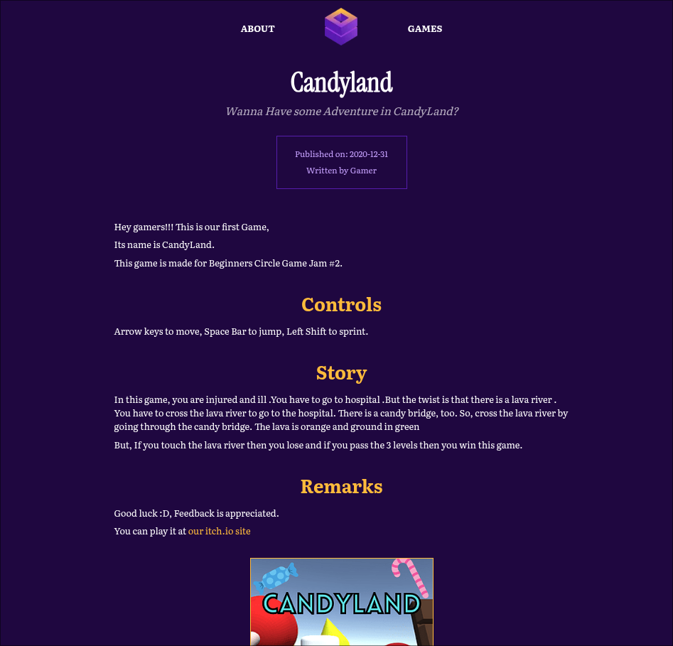
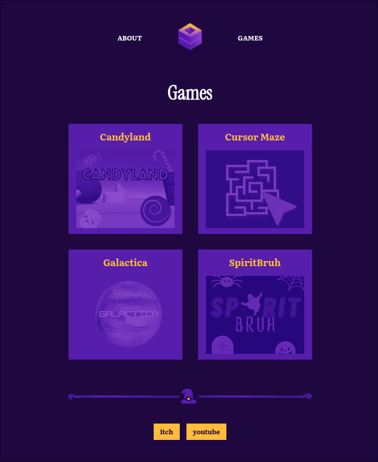

# AS Studios

This project is sort of a portfolio website of a game development studio. Made this project while I was learning about Astro and I'm astonished how easy it was to set this blog site up.

Long long time ago, I started AS Studios with a basic itch.io page. I made a few games and uploaded it to the itch page and later abandoned it for other projects. 

*chose the purplish theme because of the colorscheme of the logo of AS Studios.*

Today, I thought now or never, and fired up this website using Astro. Love how it turned out to be!!

### [demo link](https://asstudiosnp.netlify.app)

## Screenshots

